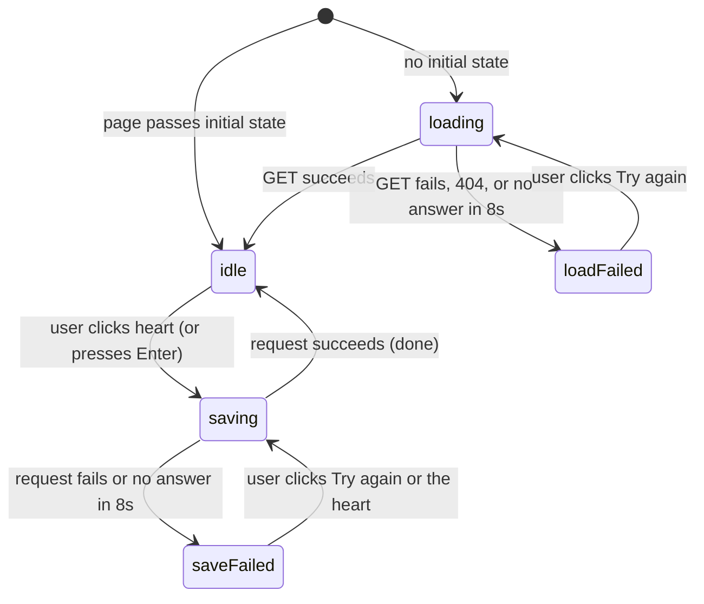

# The like button shows a post's like state and toggles it

## Why
A viewer sees at a glance whether they've liked a post and how many likes
it has, and can like or unlike it with one tap.

## Where it lives
- `apps/web/components/LikeButton.tsx` — the client component
- Calls `GET`, `POST` and `DELETE` on `/api/posts/[postId]/likes` (spec: `docs/specs/posts/likes.md`)
- Used by the posts screen (spec: `docs/specs/posts/likes-screen.md`)

## Behavior

| State | Kind | What the user sees |
|---|---|---|
| **loading** | read: loading | "Loading likes…" |
| **loadFailed** | read: error | "Likes unavailable" and a **Try again** link |
| **idle** | read: has data / write: idle or done | ♥ (liked) or ♡ (not liked) and the like count |
| **saving** | write: pending | The heart is greyed out and ignores clicks and Enter |
| **saveFailed** | write: failed | The heart and count stay as they were, plus "Couldn't save your like/unlike." and **Try again** |

- When the page already read the like state on the server, it passes it in as
  `initial` and the button starts in **idle** without a GET.
- **saving** sends `POST` (to like) or `DELETE` (to unlike). Only one request
  can be in flight: extra clicks and key presses while saving do nothing.
- After a successful save, the heart and count come from the server's
  response, not from adding or subtracting 1 in the browser.
- A request with no answer after 8 seconds counts as failed, so the button
  never stays in **saving** or **loading** forever.
- **Try again** after a failed save repeats the exact action that failed.
- If the `postId` prop changes and there is no `initial`, the button goes back
  to **loading**.

## Examples

| State / input | Behavior |
|---|---|
| Page passes `{ liked: false, count: 3 }` | ♡ 3 likes immediately, no GET |
| Viewer clicks ♡ and the server answers `{ liked: true, count: 4 }` | ♥ 4 likes |
| Viewer double-clicks, or presses Enter twice | One request; one like row |
| Viewer clicks 5 times while the request is slow | One request |
| Viewer clicks ♥ and the server is stopped | ♥ stays, count unchanged, "Couldn't save your unlike." + Try again |
| The request never answers | Same error after 8 seconds |
| No `initial` and the API returns 404 | "Likes unavailable" + Try again |
| Count is 1 | "1 like" (singular) |

## Verify
- `pnpm typecheck` passes.
- On `/sandbox/likes`: double-click the heart, then press Enter twice with it
  focused; the **Like** table gains or loses exactly one row each time.
- Stop the web server, click the heart: the error and Try again appear and the
  heart is unchanged. Start the server, click Try again: it saves.
- Keyboard pass: Tab to the heart; Enter or Space toggles it, and focus stays
  on the heart while saving.

## Constraints & decisions
- `liked` and `count` are stored once, in a single `like` object from the
  server. `isSaving`, the heart icon and the label are derived from state on
  each render, never stored separately, so they can't fall out of sync.
- No optimistic update: the UI waits for the server's answer. This keeps the
  count correct when other people like the post at the same time.
- Double-submit is blocked twice over: an in-flight guard in the button, and
  the API itself is idempotent (liking twice still leaves one row).
- The button uses `aria-disabled` rather than `disabled` while saving, so
  keyboard focus stays on it.
- Failures are logged with `console.warn`, not `console.error`, so expected
  failures don't open Next's dev error overlay.

## Out of scope
- Showing who liked a post: not specified yet.
- Optimistic updates (`useOptimistic`): not used; see Constraints & decisions.
