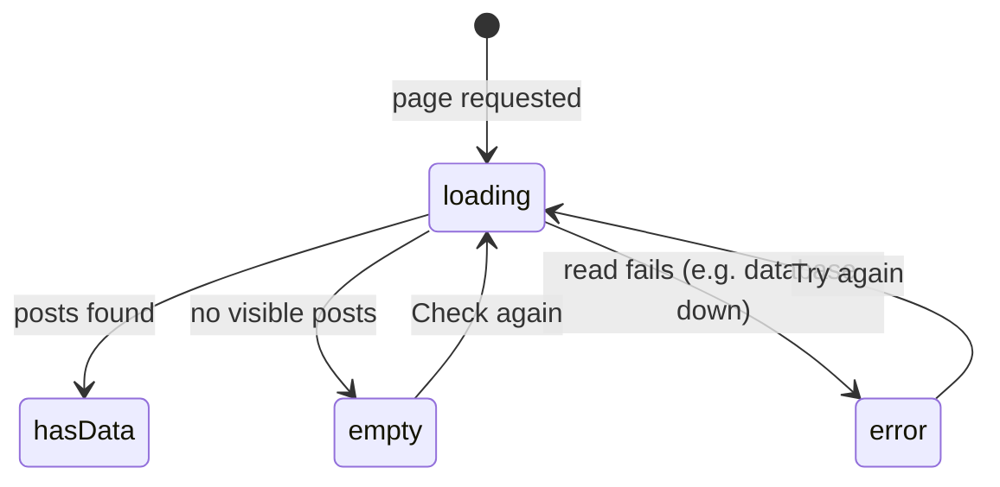

# The posts screen lists the posts you can see, each with a like button

## Why
Viewers need one place to see posts and like them. Until the real feed
exists, this lives at the sandbox route `/sandbox/likes`.

## Where it lives
- `apps/web/app/sandbox/likes/page.tsx` — reads posts on the server
- `apps/web/app/sandbox/likes/loading.tsx` — skeleton while reading
- `apps/web/app/sandbox/likes/error.tsx` — error with retry
- `packages/domain/src/likes.ts` — `listVisiblePostsWithLikes`
- `apps/web/components/LikeButton.tsx` — the write (spec: `docs/specs/posts/like-button.md`)

## Behavior

The read happens **on the server**: nothing about this list depends on the
browser, so the posts and their like state arrive with the HTML.

| State | What the user sees |
|---|---|
| **loading** | Three grey placeholder cards (`loading.tsx`) |
| **empty** | "No posts to like yet", how to add the demo post, and a **Check again** button |
| **error** | "Couldn't load posts" and a **Try again** button that re-runs the server read |
| **hasData** | Up to 20 cards, newest first: caption (or "Untitled photo"), author, date, like button |

- Posts shown are the ones the current user can see: not soft-deleted, and
  either `PUBLIC` or written by the user.
- Each card's like button starts with the server's like state, so the
  page makes no extra request per post.
- The read is always 3 database queries, however many posts there are.

## Examples

| State / input | Behavior |
|---|---|
| The seed post exists (`pnpm db:seed`) | One card: "Untitled photo", by @demo, ♡ 0 likes |
| No public posts and none of your own | Empty state with Check again |
| Database stopped, page reloaded | "Couldn't load posts" + Try again |
| Database restarted, Try again clicked | The list appears |
| Network throttled to Slow 4G, page reloaded | Skeleton cards first, then the list |

## Verify
- `pnpm test` runs `tests/integration/likes.test.ts`, including
  `listVisiblePostsWithLikes`.
- Slow it down: DevTools → Network → Slow 4G, reload `/sandbox/likes`; the
  skeleton shows before the list.
- Break it: stop the database (run only `pnpm dev:web`) and load the page; the
  error state shows. For the write side, see `like-button.md`.
- Double it: see `like-button.md`.

## Constraints & decisions
- Server read, not a browser fetch: the list doesn't depend on anything only
  the browser knows, so it renders with the page.
- `error.tsx` retries with `router.refresh()` plus `reset()`, because the
  failure happened on the server and `reset()` alone would only re-render.
- The list is capped at 20 posts; there is no pagination yet.
- `FRIENDS` and `CLOSE_FRIENDS` posts only show to their author until the
  Friendship model exists (same rule as `likes.md`).

## Out of scope
- The real feed page and its design: this is a sandbox route.
- Pagination and infinite scroll: not specified yet.
- Creating posts: owned by the create-post feature.
